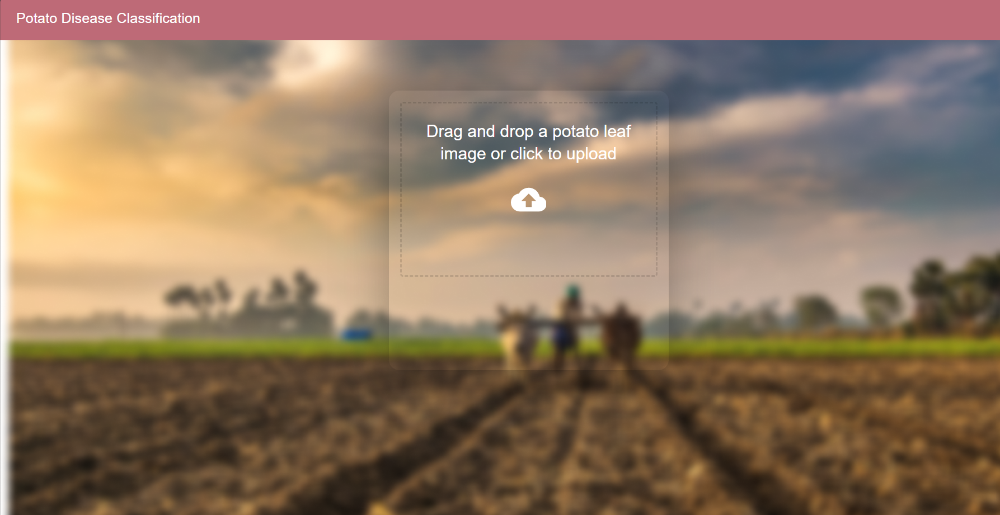
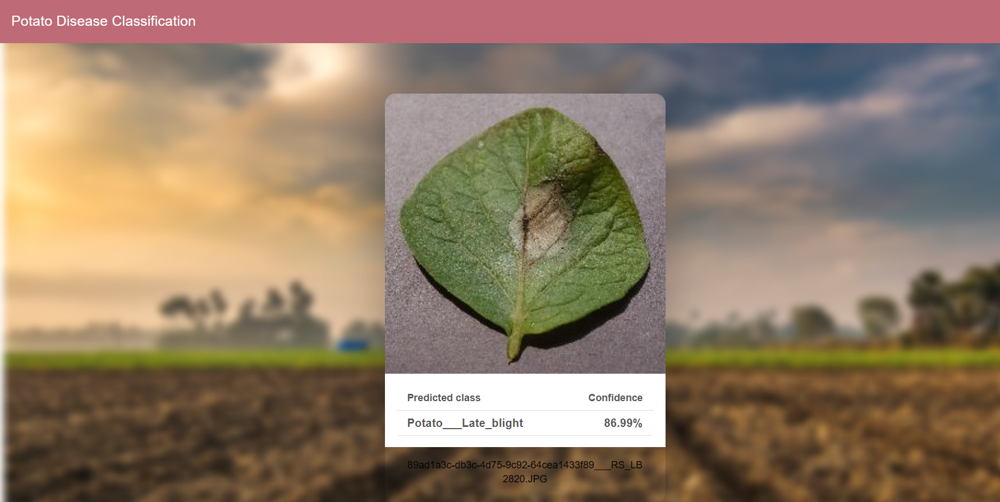
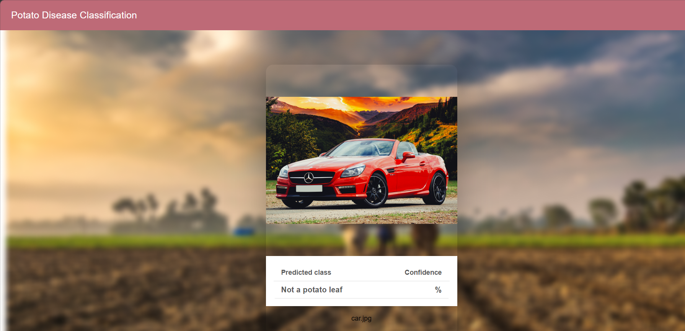

# Potato Disease Classification

An end-to-end deep learning web application that classifies potato leaf images as **Early Blight, Late Blight, or Healthy**. It combines TensorFlow/Keras models with a FastAPI backend and React frontend to provide predictions through a web interface.

## Disease Classes

- **Potato Early Blight:** `Potato___Early_blight`
- **Potato Late Blight:** `Potato___Late_blight`
- **Healthy Potato Leaf:** `Potato___healthy`

## Application Screenshots

### Application Interface



### Healthy Potato Leaf


### Early Blight


### Late Blight



### Non-Potato Image Validation



## Technologies Used

- Python
- TensorFlow and Keras
- NumPy
- Pillow (PIL)
- FastAPI
- Uvicorn
- React
- JavaScript
- Git and GitHub

## How It Works

1. The user uploads an image through the React interface.
2. The frontend sends the image to the FastAPI backend.
3. The backend validates the image using a potato leaf validation model.
4. If accepted, the image is preprocessed for the disease classification model.
5. The classifier predicts Early Blight, Late Blight, or Healthy.
6. The API returns the prediction and available confidence information.
7. The frontend displays the result.

The validator helps reject unrelated images, but it may occasionally reject a valid potato leaf or accept an unsuitable image.

## Project Structure

```text
Potato-Desease-Classification/
├── API/
│   ├── main.py
│   └── requirements.txt
├── frontend/
│   ├── public/
│   ├── src/
│   ├── package.json
│   └── package-lock.json
├── Models/
├── screenshots/
├── potato_disease_model.keras
├── potato_leaf_validator.keras
├── potato_leaf_validator_v2.keras
├── training.ipynb
├── .gitignore
└── README.md
```

Additional scripts and files may be present in the repository.

## Installation and Setup

### Prerequisites

- Python compatible with the dependencies in `API/requirements.txt`
- Node.js and npm
- Git

### 1. Clone the Repository

```bash
git clone https://github.com/sagarbhovai/Potato-Desease-Classification.git
cd Potato-Desease-Classification
```

### 2. Set Up the Backend

In PowerShell, from the project root:

```powershell
python -m venv .venv
.\.venv\Scripts\Activate.ps1
python -m pip install -r API/requirements.txt
```

### 3. Start FastAPI

From the project root:

```powershell
python -m uvicorn main:app --app-dir API --host 127.0.0.1 --port 8001
```

API documentation: http://127.0.0.1:8001/docs

Keep this terminal running.

### 4. Start React

Open a second terminal:

```powershell
cd frontend
npm install
```

For the current setup, if the legacy Webpack/OpenSSL compatibility option is required, run:

```powershell
$env:NODE_OPTIONS="--openssl-legacy-provider"
npm start
```

Open the frontend address shown in the terminal, usually http://localhost:3000.

Ensure `frontend/src/home.js` points to the backend URL:

```javascript
const API_URL = "http://127.0.0.1:8001/predict";
```

The API URL and request format must match the backend configuration.

## Models

- `potato_disease_model.keras` — disease classification model.
- `potato_leaf_validator_v2.keras` — current leaf validation model.
- `potato_leaf_validator.keras` — earlier validation model.

The backend's configured model paths must match the files available locally.

## Model Evaluation

During development, an evaluation run reported approximately **95.70% accuracy**. This figure should be interpreted in the context of the dataset and evaluation procedure used.

Accuracy alone does not establish real-world performance. Independent testing on unseen field images and additional metrics are important for evaluating reliability.

## Dataset

The PlantVillage dataset was used during model development. The dataset is excluded from the repository and must be obtained separately if you want to reproduce training. Follow the paths and instructions specified in the training notebook.

## Limitations

- Performance depends on image quality, lighting, and similarity to the training data.
- The leaf validator may produce false rejections or false acceptances.
- Prediction confidence does not guarantee that a prediction is correct.
- This application is an educational decision-support project and is not a substitute for expert agricultural advice.

## Future Improvements

- Evaluate using independent field images.
- Improve validation performance and API error handling.
- Add automated tests and model evaluation reports.
- Deploy the frontend and backend.
- Monitor model performance on new data.

## Author

**Sagar Bhovi**

GitHub: https://github.com/sagarbhovai
